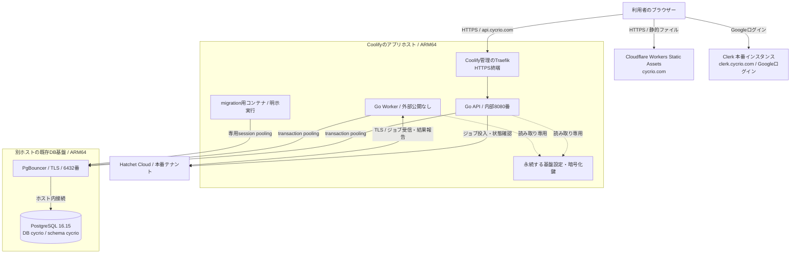

# 本番環境の構成

CycrioのWebはCloudflare、API・WorkerはセルフホストのCoolify、DBは別ホストの既存PostgreSQLに配置しています。新しい専用DBから開始し、開発環境のデータや暗号化鍵は引き継いでいません。

初回設定・更新の操作手順は[本番デプロイガイド](production.md)、鍵とデータの復元方針は[運用ガイド](operations.md)を参照してください。

## 全体構成

WebからAPIへの通信はブラウザーが直接行います。CloudflareのWeb配信はAPIの中継を行いません。Hatchet Cloudはジョブの制御基盤で、実際の処理を行うWorkerはCoolify上で動作します。

## 公開先とDNS

| 名前                       | 用途                                  | 配置・接続方式                                            |
| -------------------------- | ------------------------------------- | --------------------------------------------------------- |
| `https://cycrio.com`       | Web                                   | Cloudflare Worker `cycrio`のCustom Domain                 |
| `https://api.cycrio.com`   | API・Webhook・メールOAuthコールバック | Aレコードでアプリホストへ接続。Cloudflareのプロキシは無効 |
| `https://clerk.cycrio.com` | Clerkの公開認証エンドポイント         | Clerk指定のCNAME。Cloudflareのプロキシは無効              |

WebはSvelteKitの静的成果物`web/build/`をWorkers Static Assetsへアップロードしています。`/settings/ai`等への直接アクセスにも対応するため、`not_found_handling`は`single-page-application`です。

APIの接続先はWebビルド時に`PUBLIC_API_BASE_URL=https://api.cycrio.com`で埋め込みます。APIが許可するWeb originは`https://cycrio.com`です。

## API・Workerとデプロイ

- Coolifyの専用プロジェクト内に、API・Workerを同じDocker Composeアプリとして登録。
- 構成ファイルは[`compose.coolify.yaml`](../compose.coolify.yaml)、ビルドは[`go.Dockerfile`](../deploy/docker/go.Dockerfile)の`runtime`ステージを使用。
- アプリホストはARM64。構築時のCoolifyは4.4.2、Docker Composeは5.7.0。
- APIはCoolifyのプロキシからコンテナ内部の8080番へ転送。API・Workerのポートをホストへ直接公開しない。
- コンテナはUID/GID `10001`、読み取り専用ファイルシステム、`cap_drop: ALL`、`no-new-privileges`で実行。
- `/readyz`でAPIとWorkerのhealthを確認。WorkerはDB接続とHatchetのWorker登録状態も確認する。
- `migrate`・`manage`は`tools` profileの明示実行用。通常の常駐サービスとして起動しない。
- 自動デプロイは無効。CI通過済みコミットを選び、migrationを先行してからCoolifyでデプロイする。

## DBと接続の分離

既存のDBホストへ、Cycrio専用DB・schema・ロールを追加しています。ほかのサービスのDBをCycrioから利用しません。初期化の定義は[`init-database.sql`](../deploy/production/init-database.sql)です。

| 用途        | 接続ロール        | PgBouncerの接続先名 | pooling     | 実際のDB |
| ----------- | ----------------- | ------------------- | ----------- | -------- |
| API・Worker | `cycrio`          | `cycrio`            | transaction | `cycrio` |
| migration   | `cycrio_migrator` | `cycrio_migration`  | session     | `cycrio` |

- 通常処理用ロールにはDDL権限を付与せず、migration用ロールがDB・schemaを所有。
- `search_path`はDB単位で`cycrio,public`に設定。
- 通常処理は`default_query_exec_mode=cache_describe`を使用し、JSON等のパラメーターの型情報を保持。
- 両接続とも`sslmode=verify-full`を使用し、TLSのCAとホスト名を検証。
- PgBouncerのHBAでCycrio専用ロールの接続先とアプリホストからの接続を制限。
- SCRAM verifierをPostgreSQLとPgBouncerで一致させて認証。
- migrationは専用session接続を使い、PostgreSQLの5432番の公開範囲を広げない。

## 認証・資格情報・暗号化鍵

Clerk本番インスタンスのGoogleログインを使用します。アプリへのログインと、Gmail等のメール取得用OAuth認可は別です。ログインできても、アプリ内の利用許可や管理者権限が自動付与されることはありません。

基盤設定はアプリホストの永続ディレクトリからCompose secretsとして読み取り専用で渡します。配置先は`CYCRIO_SECRETS_DIR`で指定し、Gitのcheckoutや一時buildディレクトリとは分離しています。

| ファイル                 | 内容                                    |
| ------------------------ | --------------------------------------- |
| `bootstrap.json`         | Clerkの本番Publishable Keyと許可origin  |
| `hatchet_token`          | Hatchet Cloud本番テナントの接続トークン |
| `database_url`           | 通常処理用のDB接続情報                  |
| `migration_database_url` | migration専用のDB接続情報               |
| `keyring.json`           | 本番DB専用の暗号化鍵                    |

永続ディレクトリの権限は`0700`、配置したファイルは`0400`、所有者はUID/GID `10001`です。鍵の生成は初回migration後に行い、別ホストへバックアップして元ファイルとの一致を確認しています。

AI・Resend・メールOAuth・Clerk Backend API・Webhookの資格情報は、初期管理者の登録後に管理画面から登録し、DBへ暗号化保存します。

## 確認範囲と初期設定の残作業

構成の確認では、次を検証しています。

- PostgreSQL 16.15でのDB初期化、実行ロールの読み書き権限とDDL制限、DB/API統合テスト。
- 本番の専用session接続でのmigration適用と暗号化鍵の初期化。
- 本番DBのmigration版44、API・Workerのhealthy、HTTPSの`/readyz`のHTTP 200。
- 公開認証設定の取得、未ログイン管理APIの401、許可外originの403。
- Webのトップ・設定ページの直接アクセスと、ClerkのGoogleログインボタン表示。

初期設定として残る項目は、本番ユーザーへの管理者権限付与、管理画面での各種資格情報の登録、AI設定の接続テスト・有効化、メール接続・Webhookの実運用確認です。料金調査の週1回（168時間）も本番管理画面で設定します。開発環境の設定は自動移行していません。

DBの定期バックアップへの組み込み確認、Cycrio単体の復元訓練、監視通知の整備も運用の受入項目です。公開WebのGoogleログイン表示確認と、本人によるログイン・メール処理の実動確認は区別してください。

DNSの疎通確認では、権威DNS・複数の公開DNS・利用回線のDNSを比較します。新規レコードが権威DNSに存在しても、利用回線で同じ応答が得られるとは限らないため、キャッシュやDNS側のフィルタリングを切り分けます。
